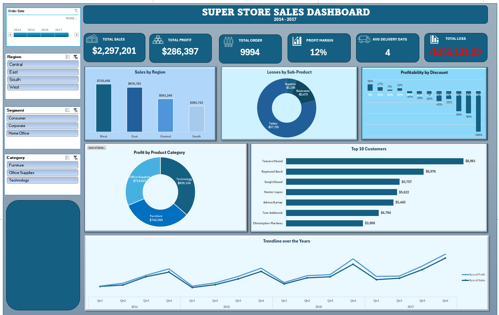

# Superstore-Sales-Analysis
# Superstore Sales Performance, Profitability & Discount Impact Analysis (2014–2017)

## 1. Project Overview
## Dashboard Preview

This project focuses on analysing the sales performance and profitability of a retail company using the Sample Superstore dataset, covering the period 2014–2017.

The analysis was conducted using Microsoft Excel, with the aim of understanding the company's sales performance, customer purchasing behaviour, regional contributions, product profitability, delivery efficiency, and the financial impact of discount strategies.

The project involved data inspection, cleaning and preparation, exploratory data analysis, PivotTable analysis, calculated columns, and the development of an interactive Excel dashboard.

A major focus of the analysis was identifying areas of the business experiencing financial losses and investigating how different discount levels relate to profitability.

## 2. Dataset Background and Business Context

The dataset was provided with a business scenario involving a growing retail superstore operating in an increasingly competitive market.

With rising market demands and intense competition, the Superstore Giant wanted to understand which aspects of its business were performing well and which areas required improvement.

The business was particularly interested in identifying:

- Products that generated the highest sales and profits.
- Regions contributing the most to business performance.
- Product categories that should receive more attention or require improvement.
- Customer segments that should be prioritised.
- Areas of the business experiencing losses.

The original dataset brief also suggested taking the analysis further by developing a regression model to predict Sales or Profit.

This project focused on the Excel-based descriptive and diagnostic analysis of the business data, with predictive modelling identified as a potential future enhancement.

## 3. Business Problem

Despite operating in a competitive market, the company needed better visibility into its sales performance and profitability to make informed business decisions.

Management needed to understand what was driving revenue, which products and regions were contributing to profitability, and which areas were creating financial losses.

In particular, the company needed to investigate whether its discount strategy was contributing to reduced profitability.

The central business question was:

**Which products, regions, categories, and customer segments should the company prioritise or reconsider to improve overall business performance and profitability?**

## 4. Project Objectives

The objectives of this analysis were to:

1. Evaluate overall sales and profitability between 2014 and 2017.
2. Identify the highest-performing and lowest-performing regions.
3. Analyse sales and profitability across product categories and sub-categories.
4. Identify products and sub-categories contributing to financial losses.
5. Investigate the relationship between discount rates and profitability.
6. Identify the top 10 customers based on sales contribution.
7. Evaluate average delivery time.
8. Examine quarterly sales and profit trends over the four-year period.
9. Develop an interactive dashboard to communicate findings and support business decision-making.

## 5. Dataset Description

The Sample Superstore dataset contains 9,994 transaction records and 21 original columns.

The dataset includes information about customer orders, products, geographical regions, sales, discounts, quantities, and profitability.

### Important Dataset Fields

| Column | Description |
|---|---|
| Row ID | Transaction record identifier |
| Order ID | Order reference |
| Order Date | Date the order was placed |
| Ship Date | Date the order was shipped |
| Ship Mode | Delivery method |
| Customer ID | Customer identifier |
| Customer Name | Customer name |
| Segment | Customer segment |
| Country | Country of sale |
| City | City of sale |
| State | State of sale |
| Postal Code | Postal code |
| Region | Sales region |
| Product ID | Product identifier |
| Category | Product category |
| Sub-Category | Product sub-category |
| Product Name | Product name |
| Sales | Revenue generated |
| Quantity | Number of products purchased |
| Discount | Discount applied |
| Profit | Profit or loss recorded |

An additional calculated column, **Delivery Days**, was created during data preparation, bringing the cleaned dataset to 22 columns.

## 6. Tools and Techniques

**Primary Tool:** Microsoft Excel

Techniques applied:

- Data inspection and cleaning.
- Data preparation.
- Calculated columns.
- Excel formulas.
- PivotTables.
- PivotCharts.
- Value filtering.
- Slicers and Timeline.
- KPI development.
- Exploratory Data Analysis (EDA).
- Interactive dashboard development.
- Business insight generation.

## 7. Project Workflow

### Step 1: Data Inspection and Understanding

I started by examining the raw dataset to understand its structure, available columns, data types, and business information.

I identified the important fields required to answer the business questions, particularly Sales, Profit, Discount, Order Date, Ship Date, Region, Category, Sub-Category, and Customer Name.

I also reviewed the dataset to understand how the available information could be used to evaluate sales performance and profitability.

### Step 2: Data Cleaning and Preparation

After inspecting the raw dataset, I created a separate worksheet for the cleaned data.

The preparation process involved reviewing the available records and ensuring that the relevant fields were suitable for analysis.

I also created an additional calculated column called **Delivery Days**.

The calculation was:

`Delivery Days = Ship Date - Order Date`

This helped measure the number of days between when an order was placed and when it was shipped.

The cleaned dataset contained 22 columns, including the newly created Delivery Days field.

### Step 3: Exploratory Data Analysis (EDA)

After preparing the dataset, I explored the available information to identify patterns, trends, and areas requiring further investigation.

The analysis focused on:

**A. Sales Performance**

Evaluating sales contributions across regions to identify the geographical areas generating the highest revenue.

**B. Profitability Analysis**

Examining profit across product categories and sub-categories to identify profitable and loss-making areas.

**C. Customer Analysis**

Evaluating customer contributions and identifying the top 10 customers based on sales.

**D. Discount Analysis**

Investigating the relationship between discount levels and profitability to understand whether aggressive discounting was associated with financial losses.

**E. Delivery Performance**

Using the calculated Delivery Days column to evaluate the average time between order placement and shipment.

### Step 4: PivotTable Analysis

I used Excel PivotTables to summarise the dataset and perform the required calculations.

The PivotTables helped analyse:

- Total sales and profit.
- Sales performance by region.
- Profitability by product category.
- Losses by product sub-category.
- Profitability across discount levels.
- Top 10 customers by sales.
- Quarterly sales and profit trends.
- Average delivery days.

I also applied value filtering to isolate transactions with negative profit values and calculate the accumulated financial losses.

### Step 5: KPI Development

I developed KPI cards to provide management with a quick overview of the company's performance.

The dashboard includes:

| KPI | Result |
|---|---:|
| Total Sales | $2,297,200.86 |
| Total Profit | $286,397.02 |
| Order Lines | 9,994 |
| Profit Margin | 12.47% |
| Average Delivery Days | 3.96 |
| Total Loss | $156,131.29 |

**KPI Calculation Definitions**

- Total Sales: Sum of all sales transactions.
- Total Profit: Sum of all recorded profit values, including negative profits.
- Profit Margin: Total Profit divided by Total Sales, multiplied by 100.
- Order Lines: Number of transaction records.
- Average Delivery Days: Average of the Delivery Days column.
- Total Loss: Absolute sum of all negative profit transactions.

### Step 6: Dashboard Development

After completing the analysis, I developed an interactive Excel dashboard to communicate the findings.

The dashboard contains the following visualisations:

**1. KPI Cards**

Displays key business performance indicators, including revenue, profit, order lines, profit margin, average delivery days, and total losses.

**2. Sales by Region**

A column chart comparing sales contributions across the four regions: West, East, Central, and South.

**3. Losses by Sub-Category**

A doughnut chart highlighting product sub-categories responsible for negative profit.

**4. Profitability by Discount**

A chart showing how profitability changes across different discount levels.

**5. Profit by Product Category**

A doughnut chart comparing profit contributions across Furniture, Office Supplies, and Technology.

**6. Top 10 Customers**

A horizontal bar chart identifying the customers contributing the highest sales.

**7. Sales and Profit Trend**

A time-series chart showing sales and profit performance across the four years, broken down by quarters.

### Step 7: Dashboard Interactivity

To make the dashboard easier to explore, I incorporated:

- Order Date Timeline.
- Region Slicer.
- Segment Slicer.
- Category Slicer.

These interactive controls allow users to filter the dashboard and examine business performance across different periods, regions, customer segments, and product categories.

## 8. Key Performance Findings and Business Insights

### Finding 1: Overall Financial Performance

The company generated approximately $2.30 million in sales and $286,397 in total profit during the analysis period.

The overall profit margin was approximately 12.47%.

This means that the company retained approximately 12.47 cents in profit for every dollar generated in sales.

### Finding 2: Regional Performance

The West region recorded the highest sales, contributing approximately $725,458.

It also generated the highest regional profit of approximately $108,418.

The South region recorded the lowest sales, at approximately $391,722.

**Business Insight:** Management should investigate the factors contributing to the West region's performance and identify opportunities to improve the South region's sales.

### Finding 3: Product Category Performance

Technology generated the highest profit at approximately $145,455.

Office Supplies followed with approximately $122,491.

Furniture recorded the lowest profit, at approximately $18,451, despite generating approximately $742,000 in sales.

**Business Insight:** High sales revenue does not necessarily translate into high profitability. Management should investigate Furniture's pricing, costs, and discount structure.

### Finding 4: Loss-Making Product Sub-Categories

Tables recorded the largest overall sub-category loss, approximately $17,725.

Bookcases and Supplies also recorded negative profit.

**Business Insight:** These sub-categories require further investigation to determine whether pricing decisions, discounts, or operating costs are affecting their profitability.

### Finding 5: Discount and Profitability Analysis

One of the most important findings was the relationship between discount rates and profitability.

The analysis showed that higher discount levels were generally associated with weaker profitability.

Several discount groups at 30% and above recorded negative overall profit.

The 70% discount group recorded the highest aggregate loss among the discount groups, approximately $40,075.

**Business Insight:** Aggressive discounting may be reducing the company's ability to maintain healthy profit margins.

Management should review its discount policies and evaluate promotional activities based on their actual profitability rather than sales volume alone.

It is important to note that this analysis identifies an association between discounts and profitability. It does not establish that discounts alone caused every loss.

### Finding 6: Total Financial Loss

The company recorded approximately $156,131 in accumulated losses across transactions with negative profit values.

**Business Insight:** Monitoring loss-making transactions is important because strong overall revenue can hide significant financial weaknesses within individual products and transactions.

## 9. Business Recommendations

Based on the findings, I recommend the following actions:

**1. Review the Discount Strategy**

Management should review high discount levels, particularly those associated with negative profitability, and introduce appropriate discount approval limits.

**2. Investigate Loss-Making Products**

Products within Tables, Bookcases, and Supplies should be reviewed to determine whether pricing, purchasing costs, or discount policies are affecting profitability.

**3. Improve Furniture Profitability**

Furniture generated substantial sales but comparatively low profit. Management should investigate its pricing structure, product costs, and promotional strategy.

**4. Strengthen Regional Performance**

The company should examine the factors contributing to the West region's strong performance and identify opportunities to improve performance in the South region.

**5. Introduce Profitability Monitoring**

Management should monitor profit margins alongside revenue when evaluating promotional campaigns and sales performance.

**6. Evaluate Customer Segments**

Management should assess the profitability and purchasing patterns of different customer segments before deciding where to concentrate marketing and promotional resources.

## 10. Future Scope

The original dataset brief suggested developing a regression model to predict Sales or Profit.

Although this project focused on descriptive and diagnostic analysis using Excel, predictive modelling would be a valuable next step.

Possible future enhancements include:

- Building a regression model to predict sales or profit.
- Identifying the factors that contribute most to financial losses.
- Forecasting future sales performance.
- Comparing discount strategies and their expected profitability.
- Developing more advanced profitability analysis using Power BI or Python.

## 11. Conclusion

This project demonstrates how Microsoft Excel can be used beyond basic calculations and reporting to investigate business performance and identify areas requiring management attention.

The analysis revealed that although the company generated substantial revenue, certain products and discount groups contributed to financial losses.

The findings also highlighted differences in regional performance, product category profitability, and customer contributions.

The most important takeaway is that increasing sales does not automatically mean increasing profitability.

Businesses need to monitor revenue, costs, discounts, and profit margins together to make better-informed decisions.

Through this project, I strengthened my practical skills in data preparation, Excel formulas, PivotTables, PivotCharts, exploratory data analysis, business interpretation, and dashboard development.

---

**Project Name:** Superstore Sales Performance, Profitability & Discount Impact Analysis

**Tool Used:** Microsoft Excel

**Project Type:** Sales Performance and Profitability Analysis

**Analysis Period:** 2014–2017

**Dataset:** Sample Superstore
